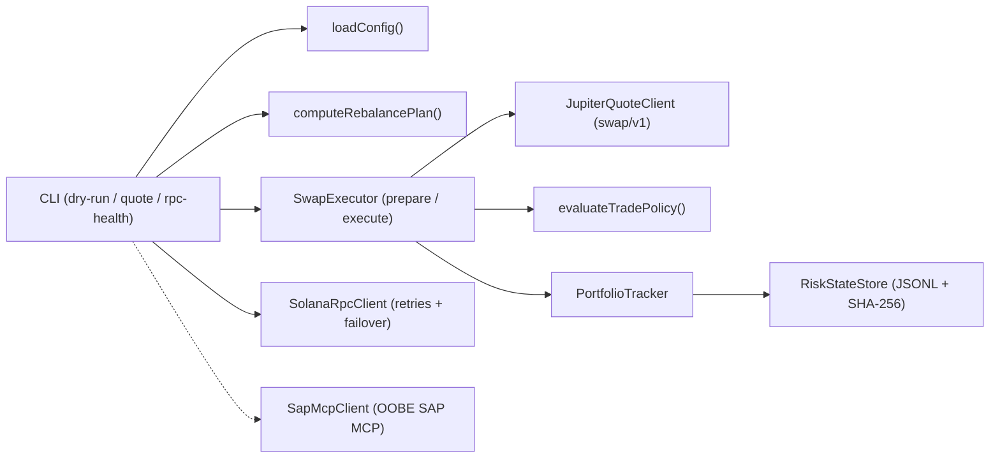

# OOBE Autonomous Capital Agent (Solana)

Autonomous Capital Agent on Solana with a deny-by-default risk policy engine, crash-safe hash-chained state store, Jupiter `swap/v1` quote adapter, Solana JSON-RPC client with retries/failover, and OOBE SAP MCP bridge.

## Architecture



## Risk Semantics

| Control | Behavior |
|---|---|
| **Non-finite inputs** | Fails closed (`DENIED`) on any `NaN` or `Infinity` in intent, snapshot, or policy |
| **Allocation cap** | Exact cross-multiplication (`amountInUsd * 10000 > maxTradeAllocationBps * totalValueUsd`) |
| **Daily drawdown** | Flow-adjusted high-water mark; resets at UTC midnight; trips `HALTED` circuit breaker |
| **Persistence** | Append-only SHA-256 hash-chained `risk-journal.jsonl` + atomic `risk-state.json` |
| **Quote freshness** | Rejects quotes older than `MAX_QUOTE_AGE_MS` or exceeding `MAX_PRICE_IMPACT_BPS` |

## Evidence Table (Superteam Earn Submission)

| Field | Value |
|---|---|
| **Steve Capital Agent URL** | `<PASTE_STEVE_CAPITAL_AGENT_URL>` |
| **Agent Wallet Address** | `<PASTE_SOLANA_WALLET_ADDRESS>` |
| **Explorer / Solscan Tx** | `<PASTE_SOLSCAN_TX_LINK>` |
| **Verified Arena XP** | `<PASTE_ARENA_XP>` |

## Quickstart

```bash
cp .env.example .env
npm install
npm run typecheck
npm test
npm run build
npm start -- --help
npm start -- dry-run
```
