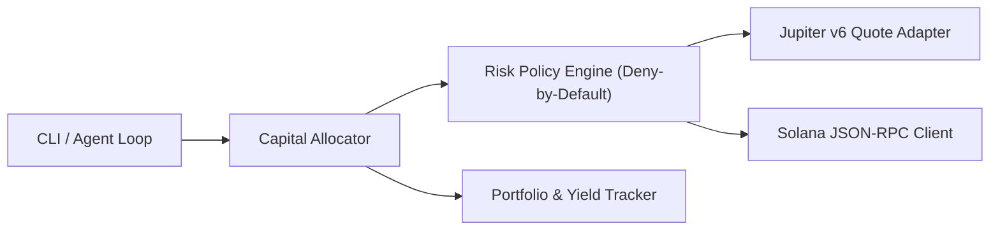

# OOBE Autonomous Capital Agent (Solana)

Production-grade **Autonomous Capital Agent on Solana** built for the **OOBE Protocol / Steve Capital Challenge** on Superteam Earn.

## Architecture



## Core Modules
- **Risk Policy Engine (`src/risk/policyEngine.ts`):** Deny-by-default guardrails enforcing max per-trade allocation (`bps`), max daily drawdown (`bps`), allowlisted token mints, slippage caps, and trade cooldowns.
- **Capital Allocator (`src/agent/capitalAllocator.ts`):** Deterministic target-weight rebalancing and yield-allocation planner with exact `bigint` lamport/token math.
- **Portfolio & Yield Tracker (`src/state/portfolioTracker.ts`):** Tracks balances, realized/unrealized PnL, drawdown, and immutable audit log entries.
- **Solana JSON-RPC Client (`src/adapters/solanaRpc.ts`):** Native `fetch` RPC client (`getHealth`, `getSlot`, `getBalance`, `getLatestBlockhash`) with `AbortController` timeouts.
- **Jupiter Quote Adapter (`src/adapters/jupiterQuote.ts`):** Live Jupiter v6 quote integration with structured error handling.

## Quickstart

```bash
cp .env.example .env
npm install
npm run typecheck
npm test
npm run build
npm start demo
```
